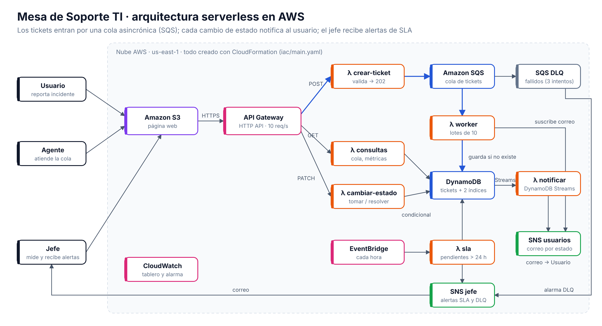

# 🏷️ [NOMBRE DEL EQUIPO] — Proyecto 10: Turnos y cola de soporte TI

> Curso **GTN-2026-2** · Gestión de Tecnologías en la Nube

Mesa de ayuda en AWS que reemplaza la atención por correo. El usuario reporta un incidente desde una página web, el ticket entra por una **cola asincrónica (SQS)**, los agentes lo atienden en orden de llegada, el usuario recibe un correo en cada cambio de estado y el jefe ve las métricas y recibe una alerta si un ticket pasa **24 horas sin atención**.

| Campo | Valor |
|---|---|
| Proyecto | 10 — Turnos y cola de soporte TI |
| Integrantes | Manuela Carmona Palacio ([código]) · Valeria Buriticá ([código]) · Karen Julieth Castaño Trujillo ([código]) |
| URL demo | [pegar el Output `SitioWebUrl` del stack] |
| Instancia (versión Docker + Jenkins) | [pegar `http://<IP o DNS público de la EC2>`] |
| Costo mensual real | USD [valor de Cost Explorer] (estimado: ≈ USD 0,9 · objetivo: USD 10) |
| Despliegue | `aws cloudformation deploy --template-file iac/main.yaml --stack-name gtn-[equipo] --capabilities CAPABILITY_NAMED_IAM` |
| Presentación | [docs/presentacion.pdf](docs/presentacion.pdf) · [versión editable .pptx](docs/presentacion.pptx) |

## 📋 Ficha del caso

| Campo | Detalle |
|---|---|
| **Problema** | La oficina de soporte TI atiende por correo: los correos se pierden, nadie sabe quién lleva cada caso y el jefe no ve los tiempos de atención. |
| **Solución** | Sistema de tickets con cola, estados (`PENDIENTE → EN_PROCESO → RESUELTO`), notificaciones por correo y métricas. No se instala nada: es una página web. |
| **Actores** | Usuario (reporta) · Agente de soporte (atiende) · Jefe de soporte (mide) |
| **Historias** | HU-01 crear ticket · HU-02 ver la cola y tomar · HU-03 cambiar estado · HU-04 métricas · HU-05 notificaciones · Reto: alerta de SLA ([docs/historias.md](docs/historias.md)) |
| **Restricciones** | Ingreso por cola asincrónica · presupuesto ≤ USD 10/mes · datos de prueba cargados |
| **Datos de prueba** | 14 tickets que se cargan solos al crear el entorno (7 resueltos, 2 en proceso, 5 pendientes, 2 de ellos fuera de SLA) |

## 🏗️ Arquitectura



**Recorrido de un ticket:** `POST /tickets` valida y deja el ticket en SQS (responde `202` de inmediato) → el *worker* lo guarda en DynamoDB como `PENDIENTE` → el agente lo ve en su cola (el más antiguo primero), lo **toma** y lo **resuelve** → cada cambio de estado le envía un correo al usuario → cada hora se revisa el SLA y se alerta al jefe.

Explicación del patrón cola: [docs/patron-cola.md](docs/patron-cola.md)

### Dos versiones del mismo sistema

| | Versión 1: servidor propio con Docker | Versión final: serverless |
|---|---|---|
| Hito | Servicio en línea (semanas 6–7) | Arquitectura y automatización (semanas 9–12) |
| Dónde corre | Contenedor Docker en la EC2 del proyecto, desplegado por **Jenkins** | Lambda, SQS, DynamoDB, SNS |
| Código / plantilla | [`app/`](app/) · [`Jenkinsfile`](Jenkinsfile) · [`iac/servidor.yaml`](iac/servidor.yaml) | [`iac/main.yaml`](iac/main.yaml) |
| Costo encendida todo el mes | ≈ USD 11,9 | ≈ USD 0,9 |

La página y la API son las mismas en las dos versiones.

## 🔑 Decisiones (resumen — la tabla completa en [docs/decisiones.md](docs/decisiones.md))

| Decisión | Elegimos | Alternativa descartada | Por qué |
|---|---|---|---|
| Cómputo | AWS Lambda | ECS Fargate con balanceador | Carga baja e intermitente; el balanceador solo ya cuesta ~USD 16/mes |
| Ingreso de tickets | SQS + cola de fallidos | Guardar directo en la base de datos | No perder tickets en picos ni si falla algo; respuesta inmediata |
| Base de datos | DynamoDB bajo demanda | RDS | RDS cuesta USD 12–15/mes siempre encendida |
| Concurrencia | Escritura condicional | Bloqueos en la aplicación | Dos agentes nunca toman el mismo ticket (el segundo recibe `409`) |
| Notificaciones | DynamoDB Streams + SNS filtrado | SES | SES en modo prueba exige verificar cada destinatario |
| Permisos | Un rol IAM por función | Un rol compartido | Mínimo privilegio; ninguna función puede borrar tickets |
| Infraestructura | Un solo template de CloudFormation | Stacks anidados | El curso exige un único comando de despliegue |

## 💰 Costos

Ver [docs/costos.md](docs/costos.md) — estimado vs real y optimizaciones aplicadas.

| Arquitectura | USD/mes |
|---|---|
| **Versión final (serverless)** | **≈ 0,9** |
| Versión 1 (EC2 t3.micro 24/7) | ≈ 11,9 |
| Contenedores + balanceador + RDS | ≈ 47 |

Seguridad y auditoría de permisos: [docs/seguridad.md](docs/seguridad.md).

## 🚀 Cómo levantar

1. **Local:** `cd app && docker compose up --build` → `http://localhost` (sin Docker: `python3 app/server.py` → `http://localhost:8080`)
2. **AWS, versión final:** `./scripts/deploy.sh <equipo> <correo-del-jefe>` (en AWS Academy agregar `LabRole` al final). Detalle, detener y destruir: [iac/README.md](iac/README.md)
3. **Instancia con Jenkins:** el [`Jenkinsfile`](Jenkinsfile) valida la IaC con `cfn-lint`, corre las pruebas, construye la imagen Docker y la despliega en la instancia con `docker compose`.

Después del primer despliegue el jefe recibe un correo de AWS para **confirmar la suscripción**; sin confirmarla no llegan las alertas.

## ✅ Pruebas

```bash
pip install pyyaml
python3 -m unittest discover -s tests       # 56 pruebas automáticas
./scripts/demo.sh <ApiUrl>                  # recorrido de extremo a extremo
./scripts/prueba-carga.sh <ApiUrl> 60 5     # ningún ticket aceptado se pierde
```

Resultados y capturas: [docs/pruebas.md](docs/pruebas.md) · evidencias de hitos: [evidencias/](evidencias/)

## 📅 Hitos

| Semana | Hito | Evidencia |
|---|---|---|
| 5 | Ficha del caso | Este README |
| 6–7 | Servicio en línea | [`app/`](app/), [`Jenkinsfile`](Jenkinsfile), [app/README.md](app/README.md) |
| 9–10 | Arquitectura (Nota 2) | [docs/arquitectura.png](docs/arquitectura.png), [docs/decisiones.md](docs/decisiones.md) |
| 11–12 | Automatización | [`iac/main.yaml`](iac/main.yaml), [`Jenkinsfile`](Jenkinsfile), [`.github/workflows/`](.github/workflows/) |
| 13–14 | Seguridad y costos | [docs/seguridad.md](docs/seguridad.md), [docs/costos.md](docs/costos.md) |
| 16 | Cierre | [docs/presentacion.pdf](docs/presentacion.pdf), [docs/pruebas.md](docs/pruebas.md) |
