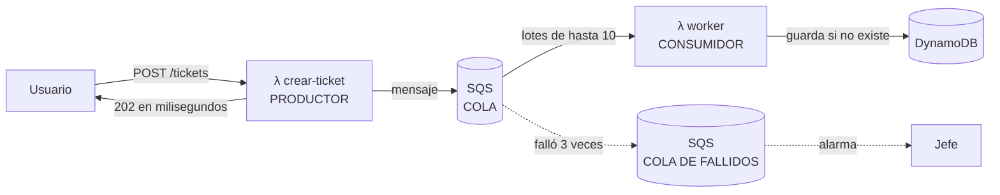

# El patrón cola

**En una frase:** se pone una cola entre quien **produce** trabajo (el usuario que reporta) y quien lo **procesa** (el sistema que guarda y notifica), para que ninguno tenga que esperar al otro.

Es el turnero de un banco. El cliente saca su ficha en un segundo y se sienta. Los cajeros llaman al siguiente a su ritmo. Si llegan 50 clientes juntos nadie se queda sin ficha: la fila crece y luego se vacía.

El nombre técnico es *queue-based load leveling* (nivelación de carga con cola), combinado con *competing consumers* (varios consumidores que se reparten los mensajes).

## Cómo se aplica en este proyecto



1. **Productor (`crear-ticket`):** valida el formulario, genera el código del ticket, publica el mensaje y responde `202 Accepted`. No toca la base de datos.
2. **Cola (SQS):** guarda el mensaje de forma durable, en varias zonas de disponibilidad, hasta por 4 días.
3. **Consumidor (`worker`):** recibe lotes de hasta 10 mensajes y guarda cada ticket como `PENDIENTE`. Como máximo corren 2 copias en paralelo.
4. **Cola de fallidos (DLQ):** si un mensaje falla 3 veces, se aparta 14 días para revisarlo sin bloquear a los demás. Una alarma le avisa al jefe.

## Qué se gana

| Sin cola | Con cola |
|---|---|
| Lunes a las 8:00, 200 personas sin internet reportan a la vez: la base de datos se satura y se pierden reportes | La cola absorbe el pico y el worker la vacía a ritmo constante (**nivelación de carga**) |
| Si la base de datos o el código fallan, el ticket se pierde y el usuario ve un error | El mensaje sigue en la cola y se reintenta solo. El usuario ya recibió su código |
| El usuario espera a que el sistema guarde, suscriba y notifique | Respuesta inmediata; el resto ocurre en segundo plano (**asincronía**) |
| Recibir y procesar son el mismo código: cambiar uno arriesga el otro | Están **desacoplados**: se cambia el worker sin tocar la API |

## Lo que cuesta

Nada es gratis: la cola introduce **consistencia eventual**. El ticket no existe en la base de datos en el instante en que la API responde, sino unos segundos después. La página lo maneja consultando hasta que aparece, y entonces muestra «pasó por la cola y quedó registrado».

## Cinco detalles para defender

| Detalle | Valor | Por qué |
|---|---|---|
| **Entrega al menos una vez** | — | SQS puede entregar el mismo mensaje dos veces. El worker guarda con la condición «solo si el ticket no existe»: procesar dos veces da el mismo resultado que una (**idempotencia**) |
| **Tiempo de invisibilidad** | 60 s | Mientras el worker procesa un mensaje, nadie más lo ve. Si falla y no lo borra, reaparece a los 60 segundos. AWS recomienda al menos 6 veces el tiempo máximo de la función (10 s) |
| **Fallos por mensaje** | `ReportBatchItemFailures` | Si falla 1 mensaje de un lote de 10, solo ese vuelve a la cola |
| **Espera larga** | 20 s | El consumidor espera hasta 20 segundos por mensajes en lugar de preguntar sin parar: menos peticiones, menos costo |
| **Tope de consumidores** | 2 | Aunque lleguen mil tickets, nunca hay más de 2 workers escribiendo. La cola hace de amortiguador |

## Hay dos colas distintas

| | Cola técnica | Cola de atención |
|---|---|---|
| Dónde vive | En SQS | En DynamoDB: los tickets en estado `PENDIENTE`, ordenados por fecha con el índice `porEstado` |
| Quién la ve | Nadie; solo el sistema | El agente, en su pantalla |
| Cuánto dura un elemento | Segundos | Horas, hasta que un agente lo toma |
| Para qué sirve | Que ningún ticket se pierda al entrar | Que los agentes atiendan en orden de llegada |

SQS no sirve como cola de atención: no deja ver la lista completa, filtrarla ni medir tiempos de espera, y un mensaje recibido desaparece para los demás. La cola de atención hay que consultarla y medirla, y eso lo hace la base de datos.

## La versión 1 también tenía cola, y por eso se cambió

En la versión 1 (`app/server.py`) la cola es una estructura **en memoria** dentro del mismo proceso. Cumple el patrón, pero con dos debilidades que SQS elimina:

| | Versión 1: cola en memoria | Versión final: SQS |
|---|---|---|
| Si el proceso se reinicia | Los tickets que estaban en la cola se pierden | Los mensajes siguen en la cola |
| Si un ticket falla al guardarse | Se registra el error y se descarta | Se reintenta 3 veces y pasa a la cola de fallidos |
| Quién consume | Un solo hilo del mismo servidor | Hasta 2 funciones, que AWS activa solo cuando hay mensajes |

## Cómo comprobarlo

```bash
./scripts/prueba-carga.sh <ApiUrl> 60 5      # la API acepta todos antes de que el worker termine de guardarlos
```

- En el tablero de CloudWatch: *mensajes enviados* y *mensajes borrados* deben coincidir; la *cola de fallidos* debe estar en cero.
- Resultados registrados en [pruebas.md](pruebas.md).
