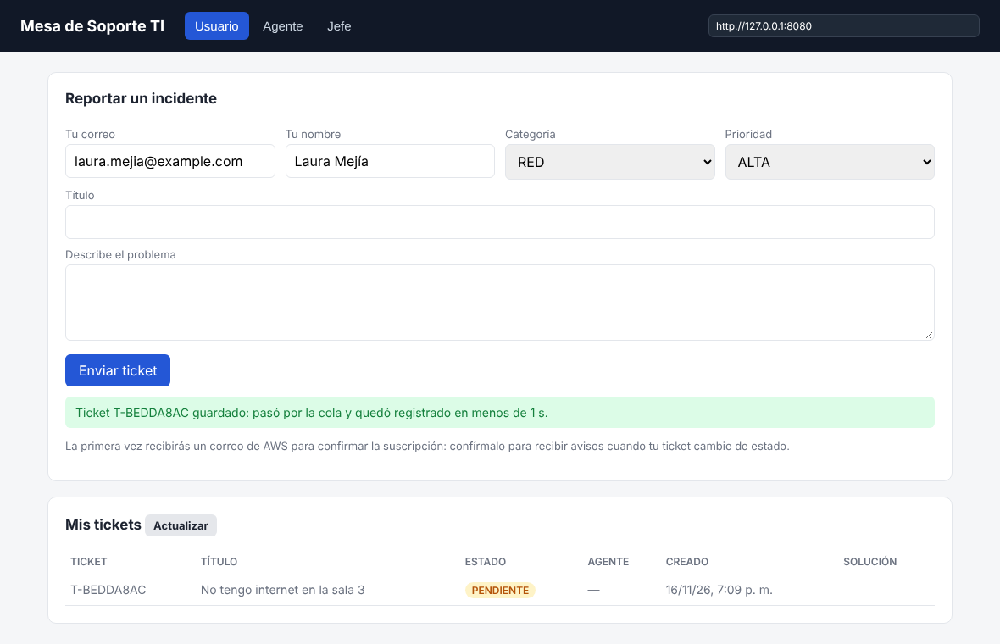
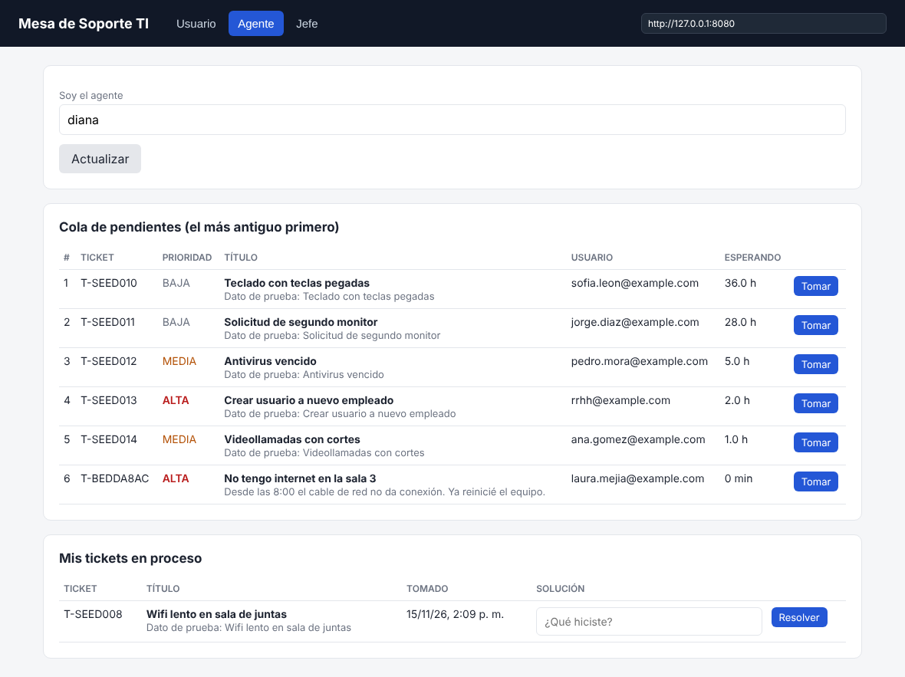
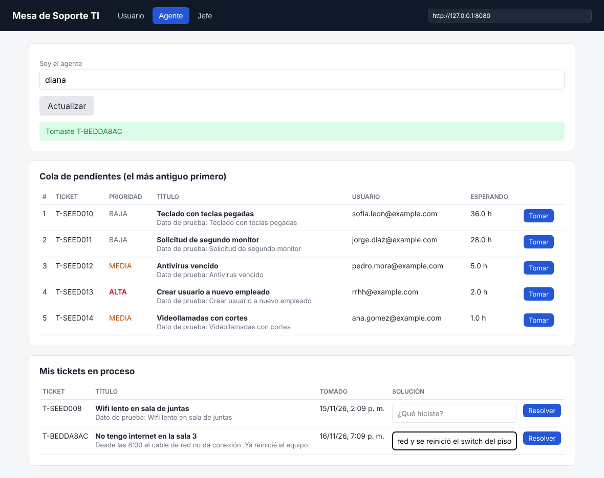
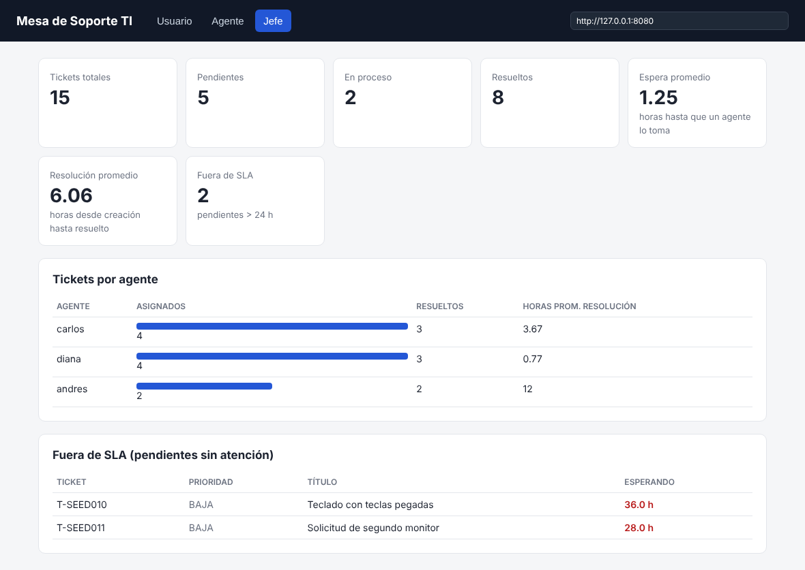
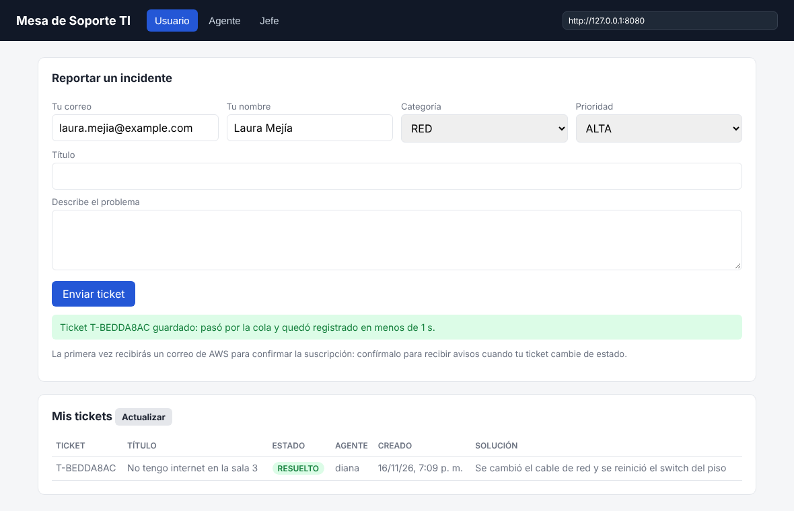
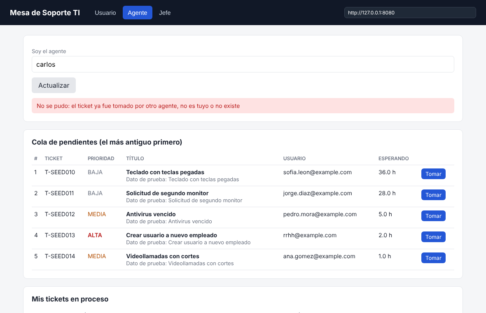

# Pruebas y resultados

**Resultado:** las 56 pruebas automáticas pasan y la versión 1 completó el recorrido de extremo a extremo, la prueba de carga y la prueba de concurrencia. **Falta** repetir esas tres pruebas contra la versión final desplegada en AWS y registrar el resultado en la [sección 5](#5-versión-final-en-aws-por-completar).

> Las salidas de este documento son de una **ejecución de referencia del 16 de noviembre de 2026**, en un computador con Linux y Python 3.13, con la versión 1 corriendo en local. Cada integrante puede repetirlas con los mismos comandos. Antes de sustentar, reemplácenlas por las salidas obtenidas en su propio entorno.

## 1. Qué se prueba y con qué

| Nivel | Herramienta | Qué comprueba | ¿Necesita AWS? |
|---|---|---|---|
| Historias de usuario | `tests/test_lambdas.py` (31 pruebas) | Cada criterio de aceptación, ejecutando el código real de las 7 funciones que está dentro de `iac/main.yaml` contra dobles en memoria de DynamoDB, SQS y SNS | No |
| Plantillas | `tests/test_plantilla.py` (18 pruebas) | Tags obligatorios, parámetros con valor por defecto, tamaño de la plantilla, un rol por función, políticas sin comodines | No |
| Versión 1 | `tests/test_app.py` (7 pruebas) | Levanta el servidor real y lo usa por HTTP, incluidas 40 peticiones simultáneas | No |
| Extremo a extremo | `scripts/demo.sh <url>` | El recorrido completo de un ticket contra un entorno en marcha (versión 1 o versión final) | Según el entorno |
| Carga y cola | `scripts/prueba-carga.sh <url>` | Que ningún ticket aceptado se pierda y cuánto tarda en quedar guardado | Según el entorno |
| Plantillas (sintaxis de AWS) | `cfn-lint` en el pipeline | Errores de CloudFormation antes de desplegar | No |

**Límite de las pruebas con dobles:** comprueban la lógica de las funciones, no los permisos IAM ni la configuración real de los servicios. Eso solo lo demuestra el despliegue en AWS.

## 2. Pruebas automáticas

```bash
pip install pyyaml
python3 -m unittest discover -s tests
```

```
Ran 56 tests in 0.698s

OK
```

| Historia | Clase de prueba | Pruebas | Ejemplos de lo que comprueban |
|---|---|---|---|
| HU-01.1 Crear ticket | `HU01CrearTicket` | 4 | Responde `202` y encola sin escribir en la base de datos; campos faltantes responden `400` |
| HU-01.2 Ingreso por cola | `HU01IngresoPorCola` | 3 | Un mensaje duplicado no duplica el ticket; un mensaje corrupto no bloquea a los demás |
| HU-02 Cola y tomar | `HU02ColaDePendientes` | 4 | La cola sale en orden de llegada; dos agentes no toman el mismo ticket |
| HU-03 Resolver | `HU03CambiarEstado` | 4 | Solo resuelve el agente asignado; no se resuelve un ticket sin tomar |
| HU-04 Métricas | `HU04Metricas` | 4 | Totales, promedios y tickets por agente con los 14 datos de prueba |
| HU-05 Notificaciones | `HU05Notificaciones` | 7 | El correo va solo al dueño del ticket; un cambio que no es de estado no notifica |
| Reto SLA | `RetoSLA` | 2 | La alerta sale una sola vez por ticket; un ticket ya tomado no alerta |
| Datos de prueba | `DatosDePrueba` | 3 | Se cargan 14 tickets; se pueden restaurar antes de una demo |
| Requisitos del curso | `RequisitosDelCurso` | 8 | Tags en todos los recursos; la plantilla cabe en el comando del curso |
| Código de las funciones | `CodigoDeLasLambdas` | 2 | El código compila y no supera 4.096 caracteres |
| Auditoría de permisos | `AuditoriaDePermisos` | 8 | Un rol por función, sin comodines, nadie puede borrar tickets |
| Versión 1 | `AppV1` | 7 | Flujo completo por HTTP y 40 tickets simultáneos sin pérdidas |

## 3. Versión 1: recorrido de extremo a extremo

```bash
python3 app/server.py &
./scripts/demo.sh http://127.0.0.1:8080
```

```
1. El usuario crea un ticket: entra a la cola y responde de inmediato
  OK    POST /tickets -> 202
        ticket: T-5A88947D
  OK    POST /tickets sin campos obligatorios -> 400
2. El worker lo guarda en segundo plano (se consulta hasta que aparezca)
  OK    GET /tickets/T-5A88947D tras 0 s -> 200
3. Aparece en la cola de pendientes
  OK    veces que aparece en GET /tickets?estado=PENDIENTE -> 1
4. Diana lo toma; Carlos lo intenta despues y es rechazado
  OK    PATCH tomar (diana) -> 200
  OK    PATCH tomar (carlos) -> conflicto -> 409
5. Solo el agente asignado puede resolverlo
  OK    PATCH resolver (carlos) -> conflicto -> 409
  OK    PATCH resolver (diana) -> 200
6. Metricas del jefe
        total: 15 | por estado: {'RESUELTO': 8, 'EN_PROCESO': 2, 'PENDIENTE': 5}
        espera promedio: 1.25 h | resolucion promedio: 6.06 h
        fuera de SLA: ['T-SEED010', 'T-SEED011']
        agente carlos - asignados: 4 resueltos: 3
        agente diana - asignados: 4 resueltos: 3
        agente andres - asignados: 2 resueltos: 2
  OK    GET /metricas -> 200

RESULTADO: todas las comprobaciones pasaron
```

Las 9 comprobaciones pasaron. El registro del servidor muestra los tres «correos» del ticket (recibido, en proceso y resuelto).

### La misma prueba en el navegador

Capturas tomadas con Chrome sobre la versión 1 en local. La página es la misma que se publica en S3 para la versión final.

| Paso | Captura |
|---|---|
| El usuario crea el ticket y la página confirma que pasó por la cola |  |
| La agente ve la cola, del más antiguo al más nuevo |  |
| La agente tomó el ticket y escribe la solución |  |
| El jefe ve totales, tiempos promedio, carga por agente y tickets fuera de SLA |  |
| El usuario ve su ticket resuelto, con la respuesta |  |

## 4. Pruebas del patrón cola y de concurrencia

### Ningún ticket aceptado se pierde

```bash
./scripts/prueba-carga.sh http://127.0.0.1:8080 60 5
./scripts/prueba-carga.sh http://127.0.0.1:8080 300 20
```

| Tickets enviados | En paralelo | Aceptados (`202`) | Tiempo en aceptarlos | Guardados | Todos guardados a los |
|---|---|---|---|---|---|
| 60 | 5 | 60 | 0,2 s | 60 | 1,3 s |
| 300 | 20 | 300 | 0,8 s | 300 | 1,9 s |

La API termina de aceptar antes de que el trabajador termine de guardar: eso es el ingreso asincrónico. Estos tiempos son de la versión 1 en un computador local, sin red de por medio. En AWS serán mayores y la API responderá `429` si se superan 10 peticiones por segundo, que es el límite configurado.

### Dos agentes, un ticket

Diana y Carlos tienen la cola abierta. Diana toma el ticket. Carlos, que todavía lo ve en su pantalla, pulsa *Tomar* después y recibe el rechazo (`409`).



## 5. Versión final en AWS (por completar)

Ejecutar con el entorno desplegado y pegar el resultado. Las capturas van en `docs/img/`.

| # | Prueba | Cómo | Resultado esperado | Resultado obtenido |
|---|---|---|---|---|
| 1 | Recorrido de extremo a extremo | `./scripts/demo.sh <ApiUrl>` | 9 comprobaciones en OK | _por completar_ |
| 2 | Carga | `./scripts/prueba-carga.sh <ApiUrl> 60 5` | 60 aceptados y 60 guardados | _por completar_ |
| 3 | Límite de peticiones | `./scripts/prueba-carga.sh <ApiUrl> 200 40` | Aparecen respuestas `429`; todo lo aceptado queda guardado | _por completar_ |
| 4 | Correo al usuario | Crear un ticket con un correo real, confirmar la suscripción, tomarlo y resolverlo | Llegan los correos de cada cambio de estado | _por completar (captura)_ |
| 5 | Alerta de SLA | `./scripts/preparar-demo.sh <equipo>` | El jefe recibe un correo con `T-SEED010` y `T-SEED011` | _por completar (captura)_ |
| 6 | Cola de fallidos y alarma | Enviar un mensaje corrupto (comando abajo) y esperar unos 10 minutos | El mensaje aparece en la cola de fallidos y el jefe recibe la alarma | _por completar (captura del tablero)_ |
| 7 | Mínimo privilegio | Comandos de la sección 6 de [seguridad.md](seguridad.md) | `implicitDeny` al simular que el rol de consultas modifica o borra | _por completar_ |
| 8 | Entorno reproducible | `./scripts/destroy.sh <equipo>` y volver a desplegar | Queda igual, con sus 14 tickets de prueba | _por completar_ |
| 9 | Costo real | Cost Explorer, filtrando por el tag `Equipo` | Menos de 10 USD al mes | _por completar en [costos.md](costos.md)_ |

Mensaje corrupto para la prueba 6 (el worker no puede guardarlo, lo reintenta 3 veces y lo aparta):

```bash
COLA=$(aws cloudformation describe-stacks --stack-name gtn-<equipo> --query "Stacks[0].Outputs[?OutputKey=='ColaUrl'].OutputValue" --output text)
aws sqs send-message --queue-url "$COLA" --message-body 'esto no es un ticket'
```
